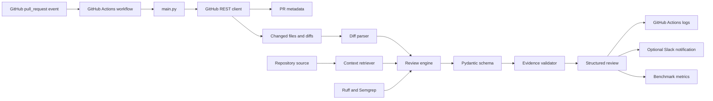

# PR Guardian Architecture

## Overview

PR Guardian runs inside GitHub Actions. A pull-request event triggers a Python
entry point, which retrieves changed files and repository context, analyzes the
diff, validates findings, records metrics, and delivers a structured review.

## Components

### GitHub Actions workflow

Triggers on `opened` and `synchronize`, installs dependencies, supplies secrets,
and runs `src/main.py`.

### GitHub client

Uses the REST API to retrieve PR metadata, changed files, diffs, and source
content. It must distinguish missing context from an API failure.

### Diff parser

Converts GitHub diffs into typed file hunks and changed line ranges. It removes
binary and deleted files from model input and records files that were skipped.

### Context retriever

Starts with direct file lookup and Python AST symbol discovery. It records every
source path and line range sent to the review engine.

### Static analysis

Ruff and Semgrep produce observations using the common finding schema. Static
results are evidence-based and are not replaced by model output.

### Review engine

The baseline prompt sends changed code to Claude with a fixed JSON contract.
The improved engine receives diff, repository context, and static observations.
Both modes return typed review objects.

### Validator

Rejects malformed output, duplicate findings, unsupported locations, and
unverifiable evidence. It also deduplicates overlapping static and LLM findings.

### Delivery

The final review is written to logs and can be posted to Slack. Benchmark runs
also write machine-readable metrics.

## Failure boundaries

- `ingestion`: GitHub or checkout failure
- `diff`: parsing or input-size failure
- `context`: repository context unavailable or retrieval failure
- `analysis`: provider or static-tool failure
- `validation`: invalid or unsupported model output
- `delivery`: notification or log output failure

No failure boundary may produce a success-shaped review.
